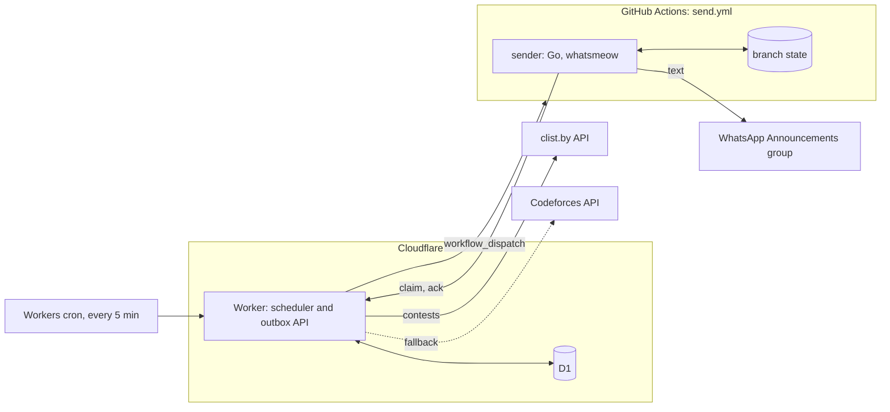
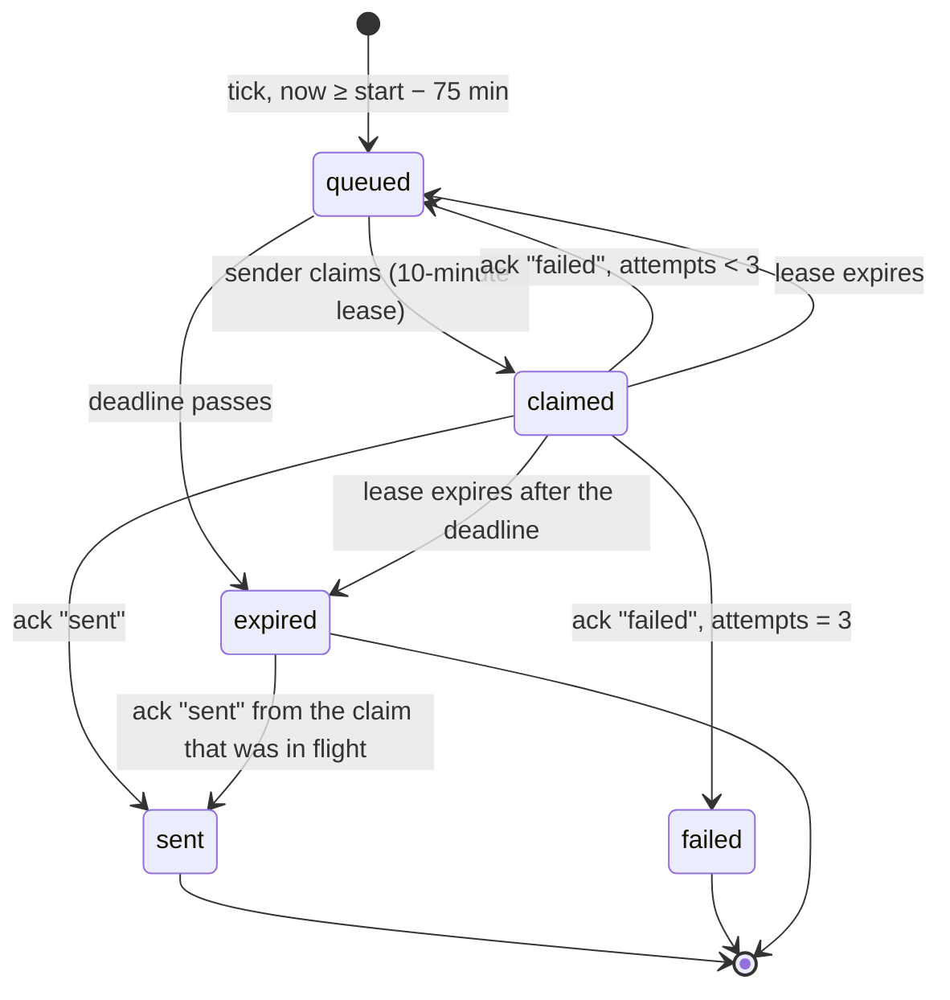
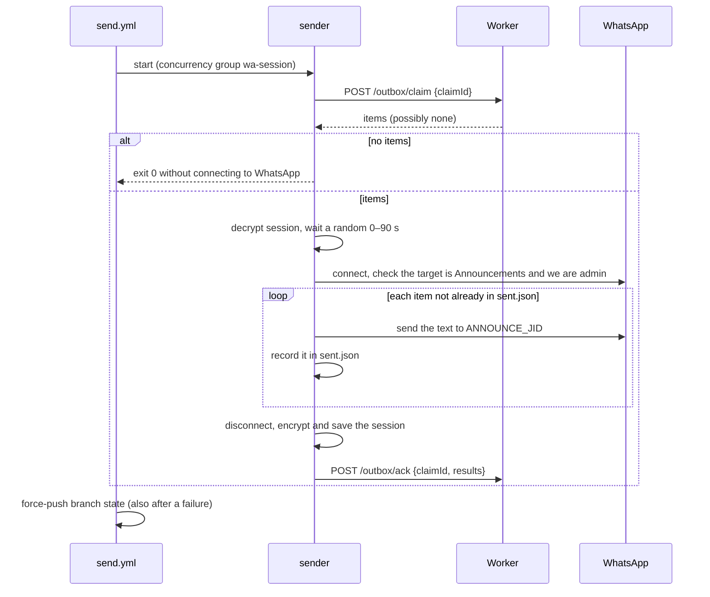

# Architecture

The bot posts a reminder for each selected programming contest into the Announcements group of a WhatsApp Community, about 75 minutes before the contest starts. It runs entirely on free hosted services.

## Requirements

| | |
|---|---|
| What | One reminder per selected contest (Codeforces, CodeChef, LeetCode, AtCoder), in the community's message format (see [formatter.md](formatter.md)). |
| Where | Exactly one chat: the community's Announcements group. Never any other group or person. |
| Delivery | Effectively once: no duplicates and no silent misses. A miss raises an alert that carries the text, ready to paste by hand. |
| Cost | $0, with no credit card. |
| Volume | 1–4 messages a day. |

## Constraints

| | |
|---|---|
| WhatsApp | No official API can post into a Community's Announcements group ([research](research/official-whatsapp-apis.md)). The sender is therefore an unofficial linked device (whatsmeow) on a spare number. Its session keys rotate on every connection and must be saved after every run, and only one connection may be live at a time. |
| Cloudflare Workers Free | 10 ms CPU per invocation, 5 cron triggers per account, 100,000 requests a day [1]. |
| Cloudflare D1 Free | 5 million rows read and 100,000 rows written a day, 500 MB per database [2]. |
| GitHub Actions | A concurrency group holds at most one pending run; a newly queued run cancels and replaces the pending one [3]. |

## Components



| Component | Responsibility | Never |
|---|---|---|
| Core (`worker/src/core/`) | Pure functions: select contests, decide which reminders are due, render the text. | Performs I/O. |
| Worker (`worker/`) | Fetches and caches contests, queues due reminders, wakes the sender, serves the outbox, reports health and a status badge. | Talks to WhatsApp or knows the target chat. |
| Sender (`sender/`) | Claims queued reminders, posts them to the one allowed chat, reports results, saves the WhatsApp session. | Decides what to send or when, or accepts a destination over the network. |
| Workflow (`.github/workflows/send.yml`) | Runs the sender with its secrets, one run at a time, and saves its state. | Carries message text: the dispatch is only a wake-up. |

## Design decisions

1. **The sender pulls from an outbox.** The Worker writes due reminders to a durable outbox in D1, and a dispatch only means "wake up and drain it". Every run drains everything pending, so a cancelled or dropped run loses nothing, and message text never appears in workflow inputs or logs.
2. **State lives in D1, not KV.** Deduplication and claiming need atomic, read-your-writes operations: `INSERT … ON CONFLICT DO NOTHING`, `UPDATE … RETURNING`, and `batch()`, which runs as one transaction [4]. KV changes can take 60 seconds or more to reach other locations [5], and its free tier allows 1,000 writes a day. D1's documentation promises general SQLite compatibility rather than these statements by name [6], so the Worker tests run them against the local D1 engine.
3. **Contests have a natural identity.** A contest is `(resource_id, href)`, the same whichever source supplied it. A reminder is `resource_id|href|start`, so a rescheduled contest gets its own reminder.
4. **Text is rendered once, when the reminder is queued.** The stored text is exactly what is sent, which makes the outbox an audit log.
5. **Only the sender knows the destination.** `ANNOUNCE_JID` is a GitHub secret. The sender refuses any chat that is not a community announcements group in which it is admin. A compromised Worker can at most post text into Announcements, five messages per run.
6. **Two independent guards against duplicates.** D1's primary key on the reminder key, and the sender's own `sent.json`, which covers a message that was sent but whose acknowledgement was lost.
7. **The session lives on a single-commit branch.** Branch `state` holds `session.db.age` and `sent.json`. Each run force-pushes one commit with a lease check, so the repository does not grow, and the workflow's concurrency group serialises the writes.

## Data

All timestamps are stored in UTC as ISO 8601 with `Z`. IST appears only in the rendered text.

### D1 tables

Schema: [`worker/migrations/0001_init.sql`](../worker/migrations/0001_init.sql).

| Table | Role | Shape |
|---|---|---|
| `contest_snapshot` | Cache of upcoming contests | One row, replaced as a whole on each refresh. `payload` is the normalised `Contest[]` JSON. |
| `reminders` | Outbox and audit log | One row per reminder, created when it becomes due and kept indefinitely (about 1,000 rows a year). The source of truth for "already handled". |
| `tip_overrides` | One-off tips | Set at runtime without a redeploy; they take precedence over the overrides in `worker/config/tips.json`. |
| `meta` | Operational facts | `last_tick_at`, `last_fetch_at`, `last_fetch_source`, `last_fetch_error`, `last_wake_at`. |

A reminder's `deadline_utc` is its start minus `minLeadMinutes` (10). After the deadline it is not worth sending.

### Reminder lifecycle



`failed` and `expired` are terminal and count as misses: they appear in `/health` and turn the badge red, and the failed workflow run emails the owner with the text in its job summary.

### Configuration

`worker/config/rules.json` (which contests, lead times) and `worker/config/tips.json` (tip rules) are bundled into the Worker at deploy. Both are described in [formatter.md](formatter.md).

### Sender state (branch `state`)

| File | Content |
|---|---|
| `session.db.age` | The whatsmeow SQLite store, encrypted with age. Plaintext never enters the repository. |
| `sent.json` | The last 500 reminders this sender delivered: `{key, sentAt, messageId}`. |

### Secrets

| Stored in | Name | Use |
|---|---|---|
| Worker | `CLIST_USERNAME`, `CLIST_API_KEY` | clist API |
| Worker | `GH_TOKEN` | Fine-grained token limited to this repository with Actions read and write; dispatches `send.yml`. |
| Worker | `TICK_TOKEN` | `POST /tick` |
| Worker | `ADMIN_TOKEN` | `GET /preview`, `PUT /tips`, `DELETE /tips` |
| Worker and GitHub | `SENDER_TOKEN` | `/outbox/claim`, `/outbox/ack` |
| GitHub | `WORKER_URL` | Base URL of the Worker |
| GitHub | `AGE_IDENTITY` | Decrypts and encrypts the session |
| GitHub | `ANNOUNCE_JID` | The only chat the sender may post to |

Every token has one purpose and is compared in constant time.

## Interfaces

### Worker HTTP API

Bodies are JSON. Authentication is `Authorization: Bearer <token>`.

| Route | Auth | Behaviour |
|---|---|---|
| `GET /health` | none | `{lastTickAt, lastFetchAt, lastFetchSource, lastFetchError, queued, claimed, failed24h, expired24h}`. Contains no secrets and no message text. |
| `GET /badge` | none | The health as a [shields.io endpoint badge](https://shields.io/badges/endpoint-badge) (see [Status badge](#status-badge)). |
| `POST /tick` | `TICK_TOKEN` | Runs one tick and returns `{fetched, queued, woke, errors}`. |
| `GET /preview` | `ADMIN_TOKEN` | The next 10 reminders with their send time in IST and rendered text. |
| `PUT /tips` | `ADMIN_TOKEN` | `{href, tip}` sets a one-off tip; an empty `tip` suppresses the tip for that contest. |
| `DELETE /tips` | `ADMIN_TOKEN` | `{href}` removes a one-off tip. |
| `POST /outbox/claim` | `SENDER_TOKEN` | `{claimId}` → `{items: [{key, text, startUtc, deadlineUtc}]}`, at most 5. Atomically moves `queued` rows, and `claimed` rows whose lease has expired, to `claimed` under `claimId`. Rows past their deadline are not returned. |
| `POST /outbox/ack` | `SENDER_TOKEN` | `{claimId, results: [{key, status: "sent" \| "failed", messageId?, error?}]}` applies the lifecycle transitions. Results for rows held by another claim are ignored. |

### Status badge

`GET /badge` returns `{schemaVersion: 1, label: "bot", message, color}` with `Cache-Control: max-age=300`. The first matching state wins:

| State | Condition | `message` | `color` |
|---|---|---|---|
| down | no tick in the last 15 minutes, or no tick ever | `no tick for 23m` / `never ticked` | `red` |
| failing | `failed24h + expired24h > 0` | `2 missed in 24h` | `red` |
| degraded | `lastFetchError` is set | `degraded: clist` | `yellow` |
| healthy | otherwise | `ok · tick 3m ago` | `brightgreen` |

The README shows it through `https://img.shields.io/endpoint?url=<WORKER_URL>/badge` [9].

### Workflow dispatch

`POST /repos/{owner}/{repo}/actions/workflows/send.yml/dispatches` with `{"ref": "main"}` and no inputs. GitHub answers `200` with the run ID [7]; the Worker treats any 2xx as success. `send.yml` has no `schedule` trigger, so GitHub's 60-day inactivity rule, which applies to scheduled workflows, does not disable it [8].

### Sender CLI

`wa keygen`, `wa pair`, `wa groups` and `wa drain`, described in [sender.md](sender.md).

## Flows

### Tick (Workers cron, every 5 minutes)

1. If the contest snapshot is older than 60 minutes, fetch clist. If clist fails or returns nothing, fetch the Codeforces API instead: its contests replace the Codeforces ones in the snapshot, and the other platforms' upcoming contests are kept. `last_fetch_error` records the clist failure even when the fallback succeeds. If both fail, the existing snapshot stays.
2. For every contest whose reminder is due, render the text and insert it as `queued` with `INSERT … ON CONFLICT(key) DO NOTHING`.
3. Mark `queued` and `claimed` rows past their deadline as `expired`.
4. If rows are waiting (`queued`, or `claimed` with an expired lease) and the last wake was more than 4 minutes ago, dispatch `send.yml` and record `last_wake_at` on a 2xx response.

`POST /tick` runs the same steps, so an external scheduler such as cron-job.org can act as a second trigger. Overlapping ticks are harmless: inserts are idempotent, and an extra wake only produces a run that finds an empty outbox.

### Send run



## Failure handling

| Failure | Effect | Handling |
|---|---|---|
| clist down or rate-limited | No fresh contest data | Codeforces fallback; contests already in the snapshot are still reminded. Shown by `/health` and a yellow badge. |
| Cron tick late or skipped | Reminder delayed | A reminder stays sendable from 75 to 10 minutes before the start, so ticks can be up to an hour late. The badge turns red after 15 minutes without a tick. |
| Dispatch fails | Sender not woken | `last_wake_at` stays unchanged, so the next tick dispatches again. |
| Pending run cancelled by a newer one | None | The outbox keeps the rows; the next run drains them. |
| Two runs at once | Prevented | Concurrency group `wa-session`. One live connection is also what WhatsApp expects of a device. |
| Sent, but the ack is lost | Risk of a duplicate | The next run finds the key in `sent.json` and acks it as sent without resending. If the deadline passes first, the row ends `expired` although the message was delivered; `sent.json` is the record of delivery. |
| WhatsApp session logged out or removed | Nothing can be sent | The run fails, GitHub emails the owner, and the job summary lists the texts. Rows return to `queued` and expire at their deadline. Re-pair with `wa pair`. |
| Contest rescheduled | Start time changes | The new start gives a new key and a new reminder. A reminder already sent for the old time stays. |
| Placeholder contest name | Generic name posted | The snapshot refreshes hourly, so names are usually final by the time a reminder is due. |
| Spare number banned | No reminders | The owner's main number owns the community; pair another number and make it admin. |

## Capacity

| Resource | Use per day | Free limit |
|---|---|---|
| Worker requests | 288 cron ticks, plus sender and badge requests | 100,000 |
| Worker CPU per tick | Parsing about 30 contests and rendering a few messages; fetches and SQL are I/O, not CPU | 10 ms |
| D1 rows written | about 24 snapshot refreshes, a few reminder transitions, 288 tick timestamps | 100,000 |
| D1 rows read | about 2,000 | 5,000,000 |
| clist requests | at most 24 | 10 a minute |
| GitHub Actions | 1–4 runs of under a minute each | 2,000 minutes a month (private repository) |

## Repository layout

```
worker/              Cloudflare Worker (pnpm workspace package)
  config/            rules.json, tips.json
  migrations/        D1 schema
  src/core/          contest selection and message formatting
  src/               scheduler, outbox API, health, badge
  test/              Worker tests in the Workers runtime with a local D1
  test/core/         golden tests against the manual reminder history
  test/fixtures/     frozen clist data and manual reminders from 2026-11-07
sender/              Go module: cmd/wa, internal/{drain,outbox,state,wa}
.github/workflows/   send.yml (drain the outbox), ci.yml (checks on push)
docs/                architecture, formatter, scheduler, sender, workflow
docs/research/       research behind the design
```

## Alternative host

The outbox API does not depend on GitHub Actions. A sender with a polling loop, running permanently on an always-free VM such as Oracle Cloud's, could call `/outbox/claim` every minute instead of being woken by a dispatch; the Worker, data model and API would stay the same. The sender has no polling mode today.

## References

1. Cloudflare Workers limits: https://developers.cloudflare.com/workers/platform/limits/
2. D1 pricing and limits: https://developers.cloudflare.com/d1/platform/pricing/, https://developers.cloudflare.com/d1/platform/limits/
3. GitHub Actions concurrency: https://docs.github.com/en/actions/writing-workflows/choosing-what-your-workflow-does/control-the-concurrency-of-workflows-and-jobs
4. D1 `batch()`: https://developers.cloudflare.com/d1/worker-api/d1-database/
5. How KV works: https://developers.cloudflare.com/kv/concepts/how-kv-works/
6. D1 SQL statements: https://developers.cloudflare.com/d1/sql-api/sql-statements/
7. Create a workflow dispatch event: https://docs.github.com/en/rest/actions/workflows#create-a-workflow-dispatch-event
8. Disabling and enabling a workflow: https://docs.github.com/en/actions/managing-workflow-runs-and-deployments/managing-workflow-runs/disabling-and-enabling-a-workflow
9. shields.io endpoint badge: https://shields.io/badges/endpoint-badge
