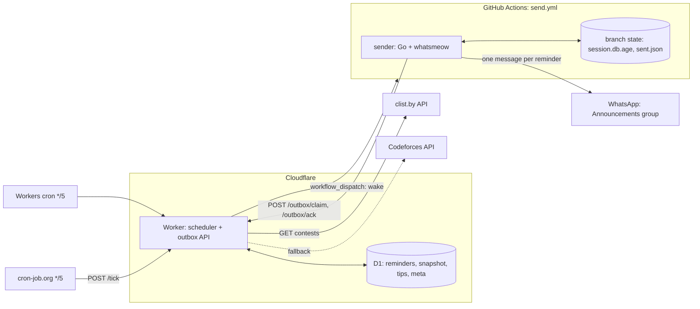
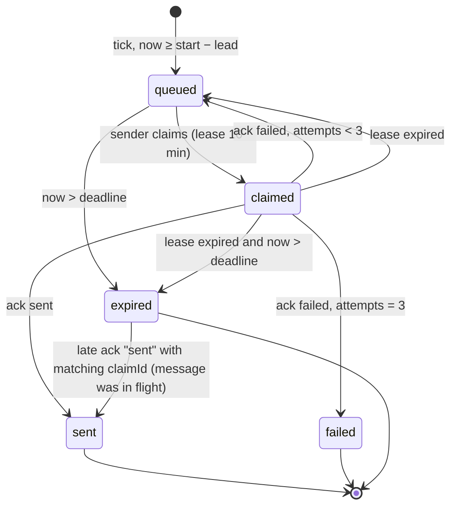
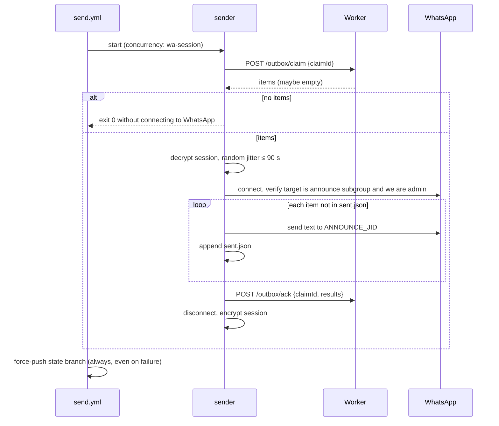

# Architecture

Contest reminders for the CP community's WhatsApp **Announcements** group, posted ~75 minutes before each contest, with no personal machine running.

## Goals and constraints

| | |
|---|---|
| Functional | Post one reminder per selected contest (Codeforces, CodeChef, LeetCode, AtCoder) to exactly one chat: the community's Announcements group. Same text format as the manual posts (`docs/formatter.md`). |
| Delivery | Effectively once: no duplicates, no silent misses. A miss must produce an alert carrying the ready-to-paste text. |
| Cost | $0 on free tiers, no credit card. |
| Volume | 1–4 messages/day. |
| Platform limits | Cloudflare Workers Free: 10 ms CPU per request, 5 cron triggers per account, 100,000 requests/day [1]. D1 Free: 5M rows read/day, 100k rows written/day, 500 MB per database [2]. GitHub Actions: at most one pending run per concurrency group; a newly queued run cancels and replaces the pending one [3]. |
| WhatsApp | No official API reaches Community announcement groups, so the sender is an unofficial linked device (whatsmeow) on a spare number. Its session keys rotate on every connection and must be persisted after every run. Only one connection may be live at a time. See `research_notes/` and `reports/`. |

## Components



| Component | Responsibility | Does not |
|---|---|---|
| Core (`src/`) | Pure functions: select contests, compute due reminders, render text. Shared by Worker and tests. | Any I/O. |
| Worker (`worker/`) | Fetch and cache contests, decide what is due, persist reminders, wake the sender, serve the outbox, expose health. | Talk to WhatsApp. Know the target chat. |
| Sender (`sender/`) | Claim queued reminders, deliver them to the one allowlisted chat, ack results, persist the WhatsApp session. | Decide what or when to send. Accept a destination from the network. |
| Workflow (`.github/workflows/send.yml`) | Run the sender with secrets, serialised, and persist state. | Carry message content (the dispatch is only a wake-up). |

## Key design decisions

1. **Outbox, pulled by the sender.** The Worker writes due reminders to a durable outbox. A dispatch only means "wake up and drain the outbox". Any run drains everything pending, so a cancelled or dropped run loses nothing, and message text never appears in workflow inputs or logs. The same API also serves the always-on fallback host: a daemon simply polls `/outbox/claim`.
2. **D1 for state, not KV.** Dedupe and claiming need atomic, read-your-writes operations (`INSERT … ON CONFLICT DO NOTHING`, `UPDATE … RETURNING`, and `batch()`, which runs as one transaction [4]). KV changes "may take up to 60 seconds or more" to reach other locations [5], and the free tier allows 1,000 writes/day. D1's docs do not list `RETURNING`/`ON CONFLICT` explicitly, only general SQLite compatibility [6], so the Worker tests exercise both against the local D1 engine.
3. **Natural contest identity.** A contest is identified by `(resource_id, href)`, which is the same whichever source the data came from. A reminder is identified by `resource_id|href|start`, so a rescheduled contest gets a new reminder.
4. **Text rendered once, when the reminder is queued.** The stored text is exactly what is sent, which gives an audit trail. Placeholder names such as `Codeforces Round (Div. 2)` are usually filled in by then because the snapshot refreshes hourly.
5. **The destination lives only with the sender.** `ANNOUNCE_JID` is a GitHub secret. The sender refuses any other chat and checks that the target is a community announcement subgroup where it is admin. A compromised Worker can at most post text to Announcements, capped per run.
6. **Two independent guards against duplicates.** The first is D1's primary key on the reminder key. The second is the sender's local `sent.json`, which covers the gap where a message was sent but its ack was lost.
7. **Session persisted on a single-commit orphan branch.** `state` holds `session.db.age` (age-encrypted SQLite) and `sent.json`. Each run force-pushes one commit with lease, so the repository does not grow. Writes are serialised by the workflow's concurrency group.

## Data architecture

All timestamps are stored in UTC, ISO 8601 with `Z`. IST exists only in rendered text.

### D1 schema (`worker/migrations/`)

```sql
CREATE TABLE contest_snapshot (
  id          INTEGER PRIMARY KEY CHECK (id = 1),
  source      TEXT    NOT NULL CHECK (source IN ('clist', 'codeforces')),
  fetched_at  TEXT    NOT NULL,
  payload     TEXT    NOT NULL
);

CREATE TABLE reminders (
  key           TEXT    PRIMARY KEY,
  resource_id   INTEGER NOT NULL,
  href          TEXT    NOT NULL,
  start_utc     TEXT    NOT NULL,
  deadline_utc  TEXT    NOT NULL,
  text          TEXT    NOT NULL,
  status        TEXT    NOT NULL CHECK (status IN ('queued', 'claimed', 'sent', 'failed', 'expired')),
  attempts      INTEGER NOT NULL DEFAULT 0,
  claim_id      TEXT,
  claimed_at    TEXT,
  message_id    TEXT,
  last_error    TEXT,
  created_at    TEXT    NOT NULL,
  updated_at    TEXT    NOT NULL,
  sent_at       TEXT
);
CREATE INDEX reminders_by_status ON reminders (status, deadline_utc);

CREATE TABLE tip_overrides (
  href        TEXT PRIMARY KEY,
  tip         TEXT NOT NULL,
  updated_at  TEXT NOT NULL
);

CREATE TABLE meta (
  k  TEXT PRIMARY KEY,
  v  TEXT NOT NULL
);
```

| Table | Kind | Why this shape |
|---|---|---|
| `contest_snapshot` | Cache, replaced wholesale | The upstream list is a cache refreshed as a unit. One row means one write per refresh, with no row-level churn. `payload` is the normalised `Contest[]` JSON. |
| `reminders` | Ledger and outbox | One row per reminder, created when due. It is the source of truth for "already handled" and is kept indefinitely as an audit log (~1,000 rows/year). |
| `tip_overrides` | Runtime config | One-off tips without a redeploy. They are merged over `config/tips.json` overrides. |
| `meta` | Operational facts | `last_tick_at`, `last_fetch_at`, `last_fetch_source`, `last_fetch_error`, `last_wake_at`. |

`deadline_utc` = start − `minLeadMinutes`. After it passes, a reminder is no longer worth sending.

### Reminder lifecycle



`failed` and `expired` are terminal and alerting. They show up in `/health`, and the workflow's failure email and job summary carry the text for manual posting.

### Static config (repo, bundled into the Worker at deploy)

`config/rules.json` (selection, lead times) and `config/tips.json` (tip rules), documented in `docs/formatter.md`.

### Sender state (branch `state`)

| File | Content |
|---|---|
| `session.db.age` | whatsmeow SQLite store, encrypted to the `AGE_IDENTITY` recipient. Plaintext never touches the repository. |
| `sent.json` | Last 500 `{key, sentAt, messageId}` delivered by this sender. |

### Secrets

| Where | Name | Purpose |
|---|---|---|
| Worker | `CLIST_USERNAME`, `CLIST_API_KEY` | clist API |
| Worker | `GH_TOKEN` | Fine-grained PAT, this repo only, Actions: read & write. Used for `workflow_dispatch`. |
| Worker | `TICK_TOKEN` | External cron → `POST /tick` |
| Worker | `ADMIN_TOKEN` | `GET /preview`, tip overrides |
| Worker and GitHub | `SENDER_TOKEN` | Sender → `/outbox/*` |
| GitHub | `WORKER_URL` | Outbox base URL |
| GitHub | `AGE_IDENTITY` | Decrypts and encrypts the session |
| GitHub | `ANNOUNCE_JID` | The only chat the sender may post to |

Each token has exactly one use, and they are compared in constant time.

## Interfaces

### Worker HTTP API

All bodies are JSON. Auth is `Authorization: Bearer <token>`.

| Method and path | Auth | Purpose |
|---|---|---|
| `GET /health` | none | `{lastTickAt, lastFetchAt, lastFetchSource, lastFetchError, queued, claimed, failed24h, expired24h}`. No secrets and no message text. |
| `POST /tick` | `TICK_TOKEN` | Runs one tick. Returns `{fetched, queued, woke}`. |
| `GET /preview` | `ADMIN_TOKEN` | Next 10 reminders: send time (IST) and rendered text. |
| `PUT /tips` | `ADMIN_TOKEN` | `{href, tip}` upserts a one-off tip. An empty `tip` suppresses the tip for that contest. |
| `DELETE /tips` | `ADMIN_TOKEN` | `{href}` |
| `POST /outbox/claim` | `SENDER_TOKEN` | `{claimId}` returns `{items: [{key, text, startUtc, deadlineUtc}]}`, at most 5 per claim. It atomically moves `queued`, and `claimed` with an expired lease, to `claimed` under `claimId`, and skips past-deadline rows. |
| `POST /outbox/ack` | `SENDER_TOKEN` | `{claimId, results: [{key, status: "sent" \| "failed", messageId?, error?}]}` applies the transitions above. Acks for a different `claimId` are ignored. |

### Workflow trigger

`POST /repos/{owner}/{repo}/actions/workflows/send.yml/dispatches` with `{"ref": "main"}`. There are no inputs.

### Sender CLI

`wa keygen`, `wa pair`, `wa groups`, `wa drain`. Details are in `docs/sender.md`.

## Flows

### Tick (every 5 minutes, from two independent triggers)
1. If the snapshot is older than 60 minutes, fetch clist. On error or an empty result, fall back to the Codeforces API, which replaces only the Codeforces contests and keeps the still-upcoming contests of other platforms from the previous snapshot. `last_fetch_error` records the clist failure even when the fallback succeeds, so `/health` shows the degraded state. If both fail, keep the old snapshot.
1. If the snapshot is older than 60 minutes, fetch clist. On error or an empty result, fall back to the Codeforces API. If both fail, keep the old snapshot and record `last_fetch_error`.
2. Compute due contests with `dueReminders(snapshot, rules, now)`. For each one, render the text and run `INSERT … ON CONFLICT(key) DO NOTHING` as `queued`.
3. Expire `queued`/`claimed` rows past their deadline.
4. If any rows are `queued` (or `claimed` with an expired lease) and `last_wake_at` is older than 4 minutes, dispatch the workflow and record `last_wake_at` after a 2xx response. The endpoint currently returns `200` with the run ID [7]. Older behaviour was `204`, and both count as success.

Overlapping ticks are safe: inserts are idempotent, and duplicate wakes only produce a run that finds an empty outbox.

### Send run



## Failure modes

| Failure | Effect | Handling |
|---|---|---|
| clist down or rate-limited | No fresh data | Codeforces fallback. The stale snapshot stays usable for already-known contests. Visible in `/health`. |
| Worker cron delayed or skipped | Late tick | cron-job.org is the second trigger. The due window (lead 75 → deadline 10 min) tolerates ticks being late by up to an hour. |
| Dispatch fails (GitHub API) | Sender not woken | `last_wake_at` is not updated, so the next tick retries. |
| Run cancelled while pending | None | The outbox still holds the rows, and the next run drains them. |
| Two runs at once | Prevented | Concurrency group `wa-session`. A single live socket is also a ban-risk requirement. |
| Sent but ack lost | Possible duplicate | `sent.json` check, then ack as sent on the next claim. |
| WhatsApp logged out, or the device was removed | Nothing can be sent | The sender fails the job: GitHub emails, and the job summary lists the claimed texts. Rows return to `queued` and expire at the deadline. Fix with `wa pair`. |
| Contest rescheduled | Start changes | New key gives a new reminder. A reminder already sent for the old time is not retracted. |
| Placeholder name at queue time | Generic name posted | Accepted. The snapshot refreshes hourly, so this is rare. |
| Spare number banned | Total outage | Main number owns the community. Re-pair a new number as admin. |

## Capacity

| Resource | Per day | Free limit |
|---|---|---|
| Worker requests | ~600 (2 × 288 ticks, plus API calls) | 100,000 |
| Worker CPU per tick | low single-digit ms; JSON parse of ~30 contests and SQL round trips are I/O | 10 ms |
| D1 writes | ~24 snapshot, ~4 reminders × ~3 transitions, ~300 meta | 100,000 |
| D1 reads | ~2,000 | 5,000,000 |
| clist requests | ≤ 24 | 10/min |
| GitHub Actions minutes | ~4 runs × ~2 min (empty runs ~30 s) | 2,000/month (private repo) |

## Repository layout

```
config/            rules.json, tips.json
src/               pure core (format, select)
test/              core tests (node:test)
fixtures/          real clist data + manual history for golden tests
worker/            Cloudflare Worker, D1 migrations, worker tests
sender/            Go module (whatsmeow), sender tests
.github/workflows/ send.yml (wake → drain), ci.yml (tests on push)
docs/              this file, formatter.md, scheduler.md, sender.md, workflow.md, operations.md
scripts/           fixture tooling
```

## Fallback deployment

If short-lived sessions on GitHub-hosted runners prove unreliable, the sender runs as a long-lived process on an Oracle Always Free VM and calls `/outbox/claim` every minute. Nothing else changes: the wake dispatch is disabled, and the API, data model and Worker stay as they are.

## References

Verified 2026-11-07.

1. Cloudflare Workers limits: https://developers.cloudflare.com/workers/platform/limits/
2. D1 pricing and limits: https://developers.cloudflare.com/d1/platform/pricing/, https://developers.cloudflare.com/d1/platform/limits/
3. GitHub Actions concurrency: https://docs.github.com/en/actions/writing-workflows/choosing-what-your-workflow-does/control-the-concurrency-of-workflows-and-jobs
4. D1 `batch()`: https://developers.cloudflare.com/d1/worker-api/d1-database/
5. How KV works: https://developers.cloudflare.com/kv/concepts/how-kv-works/
6. D1 SQL statements: https://developers.cloudflare.com/d1/sql-api/sql-statements/
7. Create a workflow dispatch event: https://docs.github.com/en/rest/actions/workflows#create-a-workflow-dispatch-event
8. Disabling workflows (only scheduled workflows are auto-disabled after 60 days without activity in public repos): https://docs.github.com/en/actions/managing-workflow-runs-and-deployments/managing-workflow-runs/disabling-and-enabling-a-workflow
